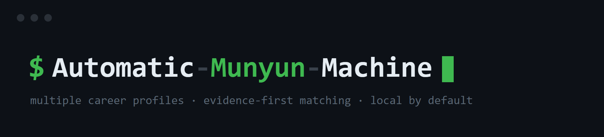

> Your resume in. Your best job matches out.

**Automatic Munyun Machine (AMM)** is a local-first desktop app that finds jobs, checks their requirements against your resume, and gives you a configurable batch of strong matches. Review everything from one dashboard, apply through direct links, and optionally send the batch to Telegram or email.

**Free · Private · Windows, macOS, and Linux · Built for any profession**

[Install](#install) · [How it works](#how-it-works) · [Features](#features) · [Privacy](#privacy) · [Troubleshooting](#troubleshooting)

---

## What AMM does

### CSV description readiness (v13.0.2)

After a keyword pull, My matches shows exactly how many full descriptions are saved. The loader uses public employer feeds when available and fills descriptions in the background. **Retry missing descriptions** retries only the published list without running AI. A CSV downloaded early contains only the text available at that moment; download it again when the panel says it is ready. Unavailable postings keep their direct links and an explicit reason. **Smart match this list** reuses the saved descriptions, and importing the downloaded CSV preserves them.

### Faster saved-list reviews (v13.0.1)

Smart Match reviews saved descriptions first, shares employer-board downloads, and groups jobs into larger parallel review batches. Completed scores remain saved if a browser closes or a request fails. A stopped worker is shown as interrupted and can be continued. Jobs without a readable full description remain awaiting review with a reason; they do not receive invented scores. Your existing model, billing connection, match floor and strong/stretch percentages stay in place. Completion time depends on the amount of saved text, employer-page availability and your AI connection.

### Review a saved list or CSV (v13)

To use your ChatGPT subscription, open **Smart Match**, choose **ChatGPT subscription** under **Match using**, and click **Connect ChatGPT**. AMM reuses your official local Codex sign-in or opens the browser sign-in flow. Install a recent Codex CLI or the ChatGPT/Codex desktop app first. Matching and resume analysis use GPT-6.1 Sol through that sign-in, draw on your included Codex allowance, and never fall back to a saved API key. If your allowance is exhausted, the review pauses with completed work saved. **API key · separate billing** remains an explicit alternative. This setting belongs to the active profile.

Already collected jobs without matching? Open **My matches → Smart match this list**. This reviews the whole current list, including your existing keyword pulls. You can also open a previous scrape and review that list.

For jobs collected elsewhere, use **Smart Match → Import CSV**. Include **Job Title** and **Apply Link** (or **Title** and **URL**) columns. AMM’s CSV exports work directly. Company, Location, Keyword and Description columns are optional. Preview the jobs, then start the review. There is no job-count limit; the CSV file must be 20 MB or smaller.

HiringCafe keyword pulls return their direct links without waiting for job-description pages. Cached full descriptions appear immediately; missing descriptions are queued for a separate background loader that yields to foreground scrapes/reviews and makes no AI calls. CSV downloads include **Company**, **HiringCafe Link**, **Job Description**, and **Description Status**. Download the CSV again as background descriptions finish to include the newly saved text; an already downloaded file cannot update itself. Paragraphs and quotes stay inside the same job’s cell. Smart Match reuses saved descriptions through CSV imports or **Smart match this list**. Missing/blocked descriptions keep their jobs with a reason, and card summaries are never labeled full JDs. TXT and XLSX remain compact link lists. For exactly 100 links, use **Settings → Keyword collection → Number of links**; the ranked strong-match target is a desired result count, not a collection limit.

Smart Match uses the active profile’s uploaded resume, saved AI connection, match percentages and exclusions. It loads full descriptions from public employer pages when necessary. If a posting has expired or the description cannot be loaded, it stays awaiting review with a reason; retry later or include its full text in a Description column. Results, exclusions and explanations appear in **Smart Match**. **Continue review** resumes that saved list, and CSV/Excel exports respect the selected list and view.

Reviews reuse saved full descriptions, read up to eight missing descriptions at once, and run up to four AI requests of 100 jobs each concurrently. Employer posting APIs and structured descriptions avoid browser visits when available. Progress shows checked jobs, unavailable descriptions and active requests. If a worker stops, AMM shows **Interrupted**; use **Continue review** to resume saved work. Large link-only lists still depend on website response times and your API limits.

Exact duplicate links reuse existing history when enabled, different roles at the same company remain separate, and applied jobs stay applied. Your original My matches list remains saved. Reviewing an imported list does not trigger automatic email or Telegram delivery.

### What happens when you use Smart Match

1. AMM collects every available page across your profile’s keywords and saves each unique posting locally with its direct application link.
2. It reads full descriptions and reviews new or changed jobs against your resume. Unchanged decisions can be reused. Progress is saved between small review batches.
3. Results and Excluded retain percentages and reasons; Job history remembers all collected jobs. You can pause, continue, restore exclusions, or explicitly mark applications.
4. AMM publishes your configured shortlist locally, with optional Telegram/email delivery. The shortlist target does not limit full collection or review. Trends records collection and review totals.

### Standard matching without full collection

1. AMM loads your active profile's locally saved resume and settings and takes a scrape lock so two runs cannot collide.
2. It searches your hiring.cafe keywords with **Remote** by default (or your chosen workplace types), **All time**, and newest first. All time includes recent jobs; it does not need to repeat overlapping date presets. Your configured recency filter still applies afterward.
3. It follows available pages and opens the extra jobs inside grouped company cards. Each failed page gets three attempts. An interrupted search or safety cap is shown as **incomplete**, not “you ran out of jobs.” Retrying starts a fresh search against the current listings.
4. It removes duplicates, previously delivered/applied jobs, and jobs blocked by your settings. When signed in, hiring.cafe also excludes Saved and Applied jobs. **Viewed stays off** so merely inspecting a description does not discard a job.
5. It reads actual job descriptions, compares requirements to your resume, and optionally sends resume evidence and job text to your chosen AI provider. Smart Match understands standard equivalent names such as SSO/single sign-on. Every returned score must validate. The dashboard distinguishes AI success, partial results, failure, missing key, and disabled scoring.
6. It keeps evaluating until it finds your target of strong matches (70% or your higher minimum), reaches the available candidate supply, or hits the description safety ceiling. A 0% minimum allows weaker fallback jobs; it no longer makes AMM stop looking early. The actual batch may be smaller than your target when too few qualifying jobs are available.
7. It publishes the highest-ranked selection locally and remembers only those delivered jobs. Selected hiring.cafe jobs are queued for **Saved**, verified after reload, and retried on later scrapes if needed. **Saved is not Applied**: applications remain your explicit action. Sign in through AMM for account synchronization; the Codex browser is a separate session.
8. Optional Telegram/email delivery follows. Failures are shown without losing the local batch. If Gmail says `reconnect-required`, reconnect Gmail in System and use the existing email/export controls to resend the batch—no new scrape needed.

Each run has an archived batch with scoring and coverage details. Daily trend percentages from older scoring versions are not directly comparable. Detailed local run summaries also retain the scorer version and whether Smart Match actually ran.

Advanced profile settings: `scoring.searchAllPages` defaults to true (5,000-page runaway guard); false restores your `maxPagesPerQuery` limit. `scoring.syncSavedJobs` defaults to true and requires `accountDedup` plus a signed-in hiring.cafe session. No new employer sources are enabled by this update.

### Overview

1. **Reads your resume** and identifies relevant titles, skills, certifications, and experience. With Smart Match configured, AI also builds a saved, profile-specific summary, verified skills, target roles, and focused search keywords.
2. **Finds jobs** on hiring.cafe and optional Greenhouse, Lever, and Ashby company boards.
3. **Filters the noise** using your location, workplace preference, experience limit, blocked companies, recency, and other settings.
4. **Ranks each job** against your resume using the listing and full job description.
5. **Delivers a daily shortlist** in the desktop dashboard, with optional Telegram and email handoff.

AMM supports technical and non-technical careers, including healthcare, sales, finance, marketing, education, HR, administration, skilled trades, and more.

## Why use it?

- **Stop repeating the same searches.** AMM runs them on your schedule.
- **See the strongest matches first.** Every job includes a match score and explanation.
- **Apply faster.** AMM resolves direct employer application links.
- **Keep control.** Choose a 50, 100, 150, or 200-job preset, or enter any positive whole number as a custom strong-match target. Tune every search or filter.
- **Keep your data local.** Your resume, history, settings, and browser session stay on your computer.

## Features

### One dashboard for the whole search

- Native Windows app window with AMM's own taskbar icon and pinning identity
- Ranked jobs with search, sorting, match filters, salary, and source details
- In Settings, below **Strong matches per batch**, enter a term such as `linux` and click **Pull all** to check every available hiring.cafe result page for your profile's workplace and location settings. Use **Collect a specific number instead** to set your own target, including counts above 1,000. Keyword collections skip resume matching and export unique direct employer or ATS application links in TXT, CSV, and XLSX. HiringCafe can show a larger count than it returns in its grouped search results. AMM reports that difference separately from an interrupted search and keeps the links it found. Results appear in Jobs and Previous scrapes.
- **Apply**, **Save**, **Applied**, and **Why this matched** actions, plus an **Open jobs** menu with 50/100/150/200 presets and a custom amount
- Resume rescan, one-click AI analysis, and profile-saved search-term suggestions
- Remote, hybrid, and on-site searches with optional location
- Blocked companies, job age, experience, salary, clearance, and application-form controls
- Multiple profiles with normal names such as `Cloud DevOps`, each with its own resume, searches, settings, and history
- An always-visible profile switcher plus a one-click, profile-specific **Auto scrape** switch on Ranked jobs; disabled profiles still support **Scrape now**
- A resume evidence viewer showing the exact extracted text used for matching
- A different VA email recipient and auto-send preference for each profile
- A saved weekday-morning toggle per profile; one unattended run processes every enabled profile without changing the profile you left open
- Trends and a search-term leaderboard to show which searches produce the best matches
- Previous scrapes: every scrape is saved for 30 days. **View** opens the complete older batch in Ranked jobs with its original stats, AI coverage, funnel, filters, Why details, and jobs; **Open jobs**, **Email**, and archive-specific `.txt`, `.csv`, and `.xlsx` exports act on the displayed saved scrape
- Dice.com built in alongside hiring.cafe: every scrape can run both, hiring.cafe only, or Dice only — with per-term routing (send "iam engineer" everywhere, keep a niche term on one source). Dice jobs carry structured salary ranges, posted dates, and workplace type, merged into the same ranking pipeline with a source badge on every ranked job. Sign in to Dice from Connections (same flow as hiring.cafe) so apply links open logged in
- Light and dark themes, desktop notifications, exports, and one-click manual scrapes

### More than one job source

AMM searches hiring.cafe and can also read public job-board feeds directly from companies using:

- Greenhouse
- Lever
- Ashby

Company-board sources are optional and disabled until you add them.

### Optional delivery

The desktop dashboard is the primary app. Extra delivery channels are optional:

- **Telegram:** receive batches and run commands from your phone
- **Email:** send the apply-link list to yourself or a helper through Gmail as `.txt`, `.csv`, or `.xlsx`
- **Export:** download `.txt`, `.csv`, or `.xlsx` files with direct apply links

### Explainable matching

AMM uses the job card for a broad first pass, then loads the full description for every candidate it evaluates until it fills the requested batch or runs out of candidates. The final score measures recognized requirement coverage, target-role fit, demonstrated resume evidence, and strict experience gaps. Standard equivalents such as SSO/Single Sign-On, Entra ID/Azure AD, and OIDC/OpenID Connect count as the same skill. The same opening found on multiple sites is delivered once. Repeated buzzwords count once.

The optional **Consultant Slop Filter** reads those full descriptions before delivery. Balanced mode removes obvious consulting, professional-services, implementation, and customer-engagement roles. Strict mode also removes any role with explicit customer-facing duties or required travel. Rejected jobs do not consume the batch target; AMM keeps evaluating later candidates for replacement engineering roles.

Optional **Smart Match** accepts a Google Gemini, Anthropic, or OpenAI API key. Paste the key once; AMM detects the provider and selects the model automatically. **Pull all & match** collects every available page across your profile’s searches before reviewing the full descriptions against your resume in small, resumable batches. The shortlist size controls your batch handoff, not how many jobs are collected or reviewed. The key stays in the private local secret file outside config backups.

OpenAI keys and the **ChatGPT subscription** connection use **GPT-6.1 Sol** for Smart Match and AI resume analysis. Subscription mode uses your saved ChatGPT sign-in through local Codex; API mode uses the saved key with separate provider billing. Changing only the connection keeps unchanged reviews for the same model.

The **Smart Match** page has Overview, Results, Excluded and Job history tabs. Save time with **Reuse saved reviews** and **Review only new or changed jobs**. Your local history keeps first/last collection dates, keywords, scores and reasons. Resume, preference, model or description changes require a fresh review. **Pause** saves progress; **Continue review** retries pending jobs without collecting again. If collection was interrupted, use **Pull all & match** again to finish finding jobs. Job history stays available when review reuse is off.

Consultant, lead/management and sales/pre-sales switches keep unwanted roles in **Excluded**, with their percentages and reasons. **Restore** overrides an exclusion. **Mark applied** records an application separately; collecting and reviewing never mark a job applied. Different openings at one company stay separate. CSV and Excel exports include direct application links, percentages and reasons for the selected view.

Smart Match’s role switches control full reviews, including duties hidden behind technical titles. Standard matching keeps its separate advanced title filters.

**Trends** offers an overview, keyword comparison and scrape history. Choose a date range and keyword to see collection hits, deduplicated jobs, strong (70%+), stretch (50–69%), below 50% and awaiting review. Keyword totals can overlap; the overall unique count deduplicates them. Awaiting review is separate from match quality. Earlier history only describes delivered batches and is labeled accordingly. Your saved percentage floor and scoring blend stay unchanged.

The same provider can analyze the scanned resume itself. On upload—or when you press **Analyze with AI**—AMM sends up to 24,000 characters of extracted resume text and saves the resulting summary, seniority, target roles, and search keywords only to that profile. AI-reported skills affect matching only when the response includes a phrase found in the resume. If no key is configured or the call fails, the built-in local parser and recommendations remain active.

By default, Smart Match is strict: if the provider fails partway through a run, AMM holds back jobs the API did not review instead of presenting local-only scores as if they were AI-audited. The Jobs page shows batch coverage and labels every row `AI verified` or `local only`; Settings can allow local fallback when quantity matters more than full AI coverage.

---

## Install

### Native installer — recommended

Download the correct file from the [latest GitHub release](https://github.com/7ustoo/automatic-munyun-machine/releases/latest):

| Platform | Download |
|---|---|
| Windows | `amm-setup-vX.Y.Z.exe` |
| macOS | `amm-vX.Y.Z.dmg` |
| Debian / Ubuntu | `amm_X.Y.Z_all.deb` |
| Other Linux | `amm-vX.Y.Z-x86_64.AppImage` |

Open the installer and follow the in-app setup.

**macOS:** open the `.dmg` and drag **AMM** into **Applications**, then launch it
from Launchpad or Applications. Everything AMM needs ships inside the app —
you do not need Node.js, npm, or the Terminal. A green `$` appears in your menu
bar and the setup panel opens automatically.

> The first launch shows *"AMM can't be opened because Apple cannot check it."*
> That's macOS Gatekeeper on an app without a paid Apple Developer signature.
> **Right-click the app → Open → Open** once, and macOS remembers it from then
> on. (Or: System Settings → Privacy & Security → "Open Anyway".)

On Windows, AMM uses Microsoft's WebView2 runtime for its native dashboard
window. Windows 10/11 commonly already includes it; the installer detects and
provisions the free Evergreen runtime when needed.

> Release artifacts may be unsigned when platform signing credentials are unavailable. Verify that the download came from this repository's Releases page.

### One-line install

Windows PowerShell:

```powershell
iwr -useb https://raw.githubusercontent.com/7ustoo/automatic-munyun-machine/main/install.ps1 | iex
```

macOS or Linux:

```bash
curl -fsSL https://raw.githubusercontent.com/7ustoo/automatic-munyun-machine/main/install.sh | bash
```

### Manual install

Requires Node.js 18+ and Git:

```bash
git clone https://github.com/7ustoo/automatic-munyun-machine.git
cd automatic-munyun-machine
npm install
npm run setup
```

AMM uses an installed Chrome or Edge browser for job collection when available. It downloads Playwright Chromium only when neither is present. On Windows, that collection browser is separate from AMM's native WebView2 dashboard window.

---

## First-time setup

The dashboard walks you through:

1. **Add your resume.** AMM suggests job searches; you can add your own terms.
2. **Choose your preferences.** Pick remote, hybrid, or on-site work and an optional location. The daily search time is already filled in.
3. **Start searching.** Use Dice immediately, or prepare hiring.cafe in a browser to search both sources.

Fresh installs start with no profession-specific searches, salary floor, experience cap, or company filters. Your searches are built from your resume, so AMM does not assume your career field. The app keeps your resume and settings on this computer.

After setup, **My matches** shows the ranked shortlist and **Scrape now** runs a search on demand. **Quick setup** can reopen with your current resume and settings and now includes Smart Match preferences. **Smart Match** holds full collection, review history, role filters and AI controls. **Settings** shows everyday choices; open **Fine-tune matching** for detailed filters. **Searches** holds your terms, with company boards and blocked companies under optional sections. Telegram, Gmail, and hiring.cafe sign-in are under **Connections** and can be added later.

## How it works

```text
Schedule or “Scrape now”
          │
          ▼
 hiring.cafe + optional company boards
          │
          ▼
 filter → deduplicate → score full descriptions
          │
          ▼
 local dashboard and batch history
          │
          ├── optional Telegram
          ├── optional email
          └── TXT / CSV / XLSX export
```

The native Go wrapper runs the local dashboard and supervises background work. On Windows it embeds that dashboard in an AMM-owned WebView2 window, so the taskbar and pinned shortcut belong to `AMM.exe` instead of Chrome. Node.js and Playwright handle job collection, resume parsing, scoring, and delivery. The dashboard binds to `127.0.0.1`, not your local network or the public internet.

When signed into hiring.cafe, AMM asks the account to hide saved and applied jobs—but not merely viewed jobs. Delivered-job history stays local and profile-scoped, so a description inspected during ranking is not lost when the job was never shown.

---

## Useful commands

Most users can do everything from the dashboard.

### Development and manual runs

```bash
npm run setup          # CLI setup fallback
npm run daily          # run a batch now
npm run login          # refresh hiring.cafe sign-in
npm run parse-resume -- "/path/to/resume.pdf"
npm test               # Node and Go regression suites
npm run check          # fast syntax checks
```

### Telegram essentials

| Command | Action |
|---|---|
| `/scrape` | Run a fresh batch |
| `/save N` | Save job number N |
| `/applied N` | Mark job number N as applied |
| `/why N` | Explain its match score |
| `/export` | Export direct apply links |
| `/settings` | Show current settings |
| `/jobs` | List or manage search terms |
| `/resume` | Upload a new resume |
| `/status` | Check app health |
| `/help` | Show all available commands |

---

## Privacy

AMM has **no telemetry** and does not run a hosted backend.

Stored locally:

- Resume and parsed keywords
- Settings and profiles
- Browser session
- Job batches, seen-job history, and application history
- Telegram, Gmail, or optional AI credentials

Network access happens only when needed for enabled features:

- hiring.cafe and configured company job boards
- open-meteo for optional weather
- Telegram or Gmail when connected
- GitHub for update checks
- Google Gemini, Anthropic, or OpenAI only when optional Smart Match is enabled

Sensitive and generated files are excluded from Git through `.gitignore`, including `.env`, `config.json`, and `data/`.

## Cost

Core AMM usage is free. hiring.cafe, public company-board feeds, Telegram, open-meteo, and local scoring do not require a paid AMM service.

Optional Smart Match uses your own Gemini, Anthropic, or OpenAI API key and may incur charges from that provider.

## Requirements

- Windows 10/11, macOS 14+, or a modern Linux distribution
- Node.js 18+ for script/manual installs; native packages can bundle the runtime
- Chrome, Edge, or space for Playwright Chromium for job collection
- Microsoft WebView2 Runtime for the native Windows dashboard (normally present; the Windows installer provisions it when missing)
- An internet connection while collecting jobs
- A machine that is awake at the scheduled time

Telegram, Gmail, and a hiring.cafe account are optional. Signing into hiring.cafe is recommended for better deduplication.

---

## Troubleshooting

### No jobs appear

Make sure you added search terms or company-board sources. Fresh v5 installs intentionally begin without someone else's searches. Then check the latest `data/daily-batch-*.log`.

### hiring.cafe is signed out or blocked

Open **System → hiring.cafe → Sign in**, or run:

```bash
npm run login
```

If a batch reports **Saved: blocked**, AMM keeps the jobs queued and rotates
failed entries behind unattempted ones. Sign in again, then run the next scrape;
verified saves leave the queue automatically.

### Smart Match reports high demand

This is a temporary response from the selected AI provider, not a failed job
search. AMM retries 429/5xx and network failures with increasing delays and
uses the provider's requested retry interval when available. If every attempt
fails, the batch is still published using local resume scoring; try the next
scrape after the provider recovers.

### Telegram does not respond

Confirm Telegram is enabled in **System**, validate the bot token and chat, then restart AMM from the tray menu.

### The resume picker does not open

Enter the file path manually or use the dashboard upload. Headless sessions may not support a native file picker.

### A PowerShell or command window flashes on Windows

Update AMM to the latest release. Background jobs run through the native
`AMM.exe` launcher, so the scheduled batch, five-minute watchdog, missed-batch
check, notifications, and browser sign-in helpers do not create terminal
windows. The Windows installer automatically replaces older scheduled-task
definitions during an upgrade.

### Check for updates says up to date, but the app is still old

An interrupted Windows install can copy the version file before replacing
`AMM.exe`. Version 12.1.1 checks the executable too and offers a repair update
when this happens. If an older version reports that it is current, download
the latest Windows installer from the [GitHub Releases page](https://github.com/7ustoo/automatic-munyun-machine/releases), close AMM, and run the installer. Your local settings and job history remain in place. Installer diagnostics are saved under `data/update/installer.log`.

### Need more help?

Check the [open issues](https://github.com/7ustoo/automatic-munyun-machine/issues) or create one with your OS, AMM version, and the relevant log excerpt. Remove personal details and tokens before posting logs.

---

## Contributing

Contributions are welcome. Useful areas include:

- Job-source adapters under `scripts/sources/`
- Resume vocabulary in `scripts/cv-keywords.json`
- Cross-platform installer and scheduler testing
- hiring.cafe selector updates

Before opening a pull request:

```bash
npm run check
npm test
npm run test:ui
```

See [CHANGELOG.md](CHANGELOG.md) for release history and [CONTEXT.md](CONTEXT.md) for the current architecture.

## License

[MIT](LICENSE)
